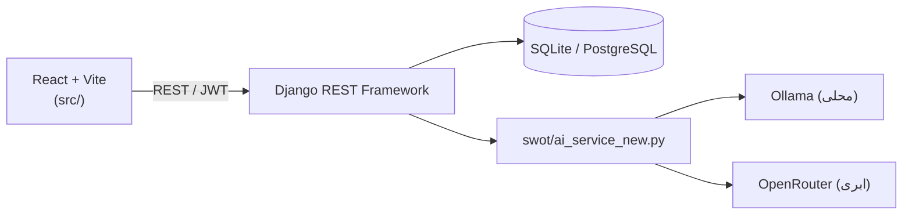

<div align="center">

# 🎓 آزمونه | Azmooneh

**سامانهٔ آزمون آنلاین و تحلیل SWOT دانشجویان با هوش مصنوعی**

رابط کاملاً فارسی (RTL) · نقش‌های استاد و دانشجو · تحلیل شخصیت و پیشنهاد شغلی با LLM محلی یا ابری

[](https://www.python.org/)
[](https://www.djangoproject.com/)
[](https://react.dev/)
[](https://vitejs.dev/)
[](#-تنظیم-هوش-مصنوعی)

[ویژگی‌ها](#-ویژگیها) · [شروع سریع](#-شروع-سریع) · [هوش مصنوعی](#-تنظیم-هوش-مصنوعی) · [ساختار پروژه](#-ساختار-پروژه) · [مستندات](#-مستندات)

</div>

---

## 📌 درباره

**آزمونه** یک پلتفرم آموزشی است که دو کار را در کنار هم انجام می‌دهد:

| | |
|:--|:--|
| 📝 **آزمون آنلاین** | استاد آزمون می‌سازد، دانشجو در آن شرکت می‌کند، سوالات بسته خودکار و سوالات تشریحی دستی نمره‌دهی می‌شوند. |
| 🧠 **تحلیل SWOT** | دانشجو به پرسش‌نامهٔ نقاط قوت، ضعف، فرصت‌ها و تهدیدها پاسخ می‌دهد و یک مدل زبانی، ارزیابی شخصیت و پیشنهاد شغلی تولید می‌کند. |

---

## ✨ ویژگی‌ها

<table>
<tr>
<td width="50%" valign="top">

### 👨‍🎓 دانشجو
- ثبت‌نام و ورود با شماره دانشجویی
- شرکت در آزمون‌ها و مشاهدهٔ نتایج
- تکمیل پرسش‌نامهٔ SWOT
- دریافت تحلیل شخصیت و پیشنهاد شغلی با AI
- تاریخچهٔ تحلیل‌های قبلی
- ارسال پیام به استاد

</td>
<td width="50%" valign="top">

### 👨‍🏫 استاد
- ساخت و مدیریت آزمون
- چهار نوع سوال: چندگزینه‌ای، تک‌گزینه‌ای، صحیح/غلط، تشریحی
- نمره‌دهی خودکار و دستی
- مشاهدهٔ پاسخ‌ها و تحلیل‌های SWOT دانشجویان
- دریافت پیام‌های دانشجویان
- داشبورد آماری

</td>
</tr>
</table>

---

## 🚀 شروع سریع

### پیش‌نیازها

- **Python** 3.8 یا بالاتر
- **Node.js** 18 یا بالاتر (برای Vite 6)
- **Ollama** برای اجرای محلی مدل — یا یک کلید API از **OpenRouter**

### ویندوز: اجرای یک‌مرحله‌ای

```bat
run.bat
```

این اسکریپت محیط مجازی را می‌سازد، وابستگی‌های Python و npm را نصب می‌کند، Backend و Frontend را در دو پنجرهٔ جدا اجرا می‌کند و مرورگر را باز می‌کند.
در اجرای اول، مراحل ۳ و ۴ پایین (پایگاه داده و تنظیم AI) را جداگانه انجام دهید.

### نصب دستی

```bash
# ۱. دریافت پروژه
git clone https://github.com/DanixMP/Azmooneh.git
cd Azmooneh

# ۲. Backend
python -m venv env
source env/bin/activate          # ویندوز: env\Scripts\activate
pip install -r requirements.txt

# ۳. پایگاه داده و داده‌های اولیه
python manage.py migrate
python manage.py populate_swot_questions
python manage.py createsuperuser   # اختیاری، برای پنل ادمین

# ۴. تنظیمات هوش مصنوعی
cp ai_config.example.json ai_config.json

# ۵. Frontend
npm install
```

### اجرا

```bash
python manage.py runserver   # ترمینال ۱ — Backend
npm run dev                  # ترمینال ۲ — Frontend
```

| سرویس | آدرس |
|:--|:--|
| 🎨 رابط کاربری | http://localhost:5173 |
| 🔧 API | http://localhost:8000/api/ |
| ⚙️ پنل ادمین Django | http://localhost:8000/admin/ |

> آدرس API در Frontend از متغیر `VITE_API_URL` خوانده می‌شود و در صورت نبودن، `http://localhost:8000` است.

---

## 🤖 تنظیم هوش مصنوعی

تنظیمات در فایل `ai_config.json` در ریشهٔ پروژه قرار دارد. مقدار `active_provider` تعیین می‌کند کدام سرویس استفاده شود.

<details open>
<summary><b>گزینهٔ ۱ — Ollama (محلی، رایگان)</b></summary>

```bash
# نصب Ollama از https://ollama.com و دریافت مدل
ollama pull gemma3:1b
```

```json
{
  "active_provider": "local_llm",
  "providers": {
    "local_llm": {
      "base_url": "http://localhost:11434",
      "model": "gemma3:1b",
      "api_type": "ollama"
    }
  }
}
```

</details>

<details>
<summary><b>گزینهٔ ۲ — OpenRouter (ابری)</b></summary>

```json
{
  "active_provider": "openrouter",
  "providers": {
    "openrouter": {
      "api_key": "YOUR_OPENROUTER_API_KEY_HERE",
      "model": "meta-llama/llama-3.3-70b-instruct",
      "site_url": "http://localhost:8000",
      "site_name": "SWOT Analysis System"
    }
  }
}
```

</details>

برای بررسی اتصال به مدل:

```bash
python test_new_ai.py
```

---

## 🏗️ معماری



### مسیرهای اصلی API

| پیشوند | اپ | کاربرد |
|:--|:--|:--|
| `/api/auth/` | `accounts` | ثبت‌نام و ورود دانشجو، ورود استاد، کاربر جاری |
| `/api/exams/` , `/api/student-exams/` | `exams` | آزمون‌ها، سوالات و پاسخ‌های دانشجو |
| `/api/swot/questions/` , `/api/swot/analyses/` | `swot` | پرسش‌نامه، ثبت پاسخ و اجرای تحلیل AI |
| `/api/messages/` | `student_messages` | پیام‌های دانشجو به استاد |

جزئیات کامل در [`docs/05-api-docs.md`](./docs/05-api-docs.md) و [`backend/API_DOCS.md`](./backend/API_DOCS.md).

---

## 📁 ساختار پروژه

```
Azmooneh/
├── backend/            # تنظیمات و URLهای اصلی Django
├── accounts/           # کاربر سفارشی با نقش‌های استاد / دانشجو
├── exams/              # آزمون، سوال، گزینه و نمره‌دهی
├── swot/               # پرسش‌نامهٔ SWOT و سرویس هوش مصنوعی
│   ├── ai_providers/   # اتصال به Ollama و OpenRouter
│   └── management/     # دستور populate_swot_questions
├── student_messages/   # پیام‌رسانی دانشجو و استاد
├── src/                # Frontend (React + TypeScript)
│   ├── components/     # داشبوردها، مودال‌ها و صفحات SWOT
│   ├── contexts/       # AuthContext
│   └── services/       # کلاینت API
├── docs/               # مستندات فارسی
├── ai_config.example.json
├── requirements.txt
├── package.json
└── run.bat             # اجرای سریع در ویندوز
```

### تکنولوژی‌ها

| لایه | ابزارها |
|:--|:--|
| Backend | Django 4.2، Django REST Framework، SimpleJWT، django-cors-headers |
| Frontend | React 18، TypeScript، Vite 6، Tailwind CSS، Radix UI، Recharts، Motion |
| هوش مصنوعی | Ollama (پیش‌فرض: `gemma3:1b`)، OpenRouter |
| پایگاه داده | SQLite در توسعه، PostgreSQL در Production |

---

## 🧪 تست

```bash
python manage.py test              # همهٔ اپ‌ها
python manage.py test swot         # یک اپ مشخص
python test_new_ai.py              # تست اتصال به سرویس AI
```

---

## 📚 مستندات

| | سند | موضوع |
|:--:|:--|:--|
| 1 | [مقدمه](./docs/01-introduction.md) | آشنایی با سیستم و قابلیت‌ها |
| 2 | [معماری](./docs/02-architecture.md) | ساختار فنی و طراحی |
| 3 | [نصب](./docs/03-installation.md) | راهنمای گام‌به‌گام نصب |
| 4 | [استفاده](./docs/04-usage.md) | راهنمای کاربران |
| 5 | [API](./docs/05-api-docs.md) | مستندات endpointها |
| 6 | [تحلیل AI](./docs/06-ai-analysis.md) | نحوهٔ کار تحلیل هوش مصنوعی |
| 7 | [استقرار](./docs/07-deployment.md) | راه‌اندازی در Production |
| 8 | [خلاصهٔ کد](./docs/08-codebase-summary.md) | مرور کدبیس |
| 9 | [مرجع سریع](./docs/09-quick-reference.md) | دستورات و نکات پرکاربرد |

تاریخچهٔ تغییرات در [CHANGELOG.md](./CHANGELOG.md) است.

---

## 🤝 مشارکت

مشارکت شما باعث خوشحالی است. پیش از ارسال Pull Request، [راهنمای مشارکت](./CONTRIBUTING.md) را بخوانید.

```bash
git checkout -b feature/my-feature
git commit -m "feat: توضیح تغییر"
git push origin feature/my-feature
```

پیام‌های commit از قالب [Conventional Commits](https://www.conventionalcommits.org/) پیروی می‌کنند: `feat` · `fix` · `docs` · `refactor` · `test` · `chore`

برای گزارش باگ یا پیشنهاد، یک [Issue](https://github.com/DanixMP/Azmooneh/issues) باز کنید.

---

<div align="center">

ساخته شده با ❤️ برای آموزش بهتر

[⬆ بازگشت به بالا](#-آزمونه--azmooneh)

</div>
